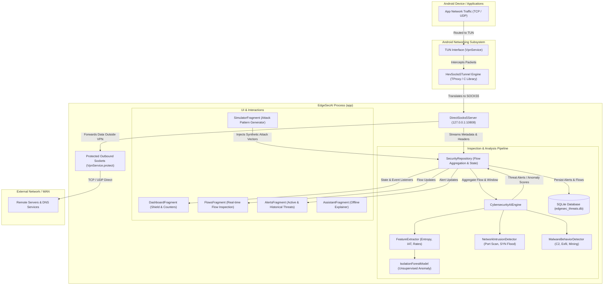
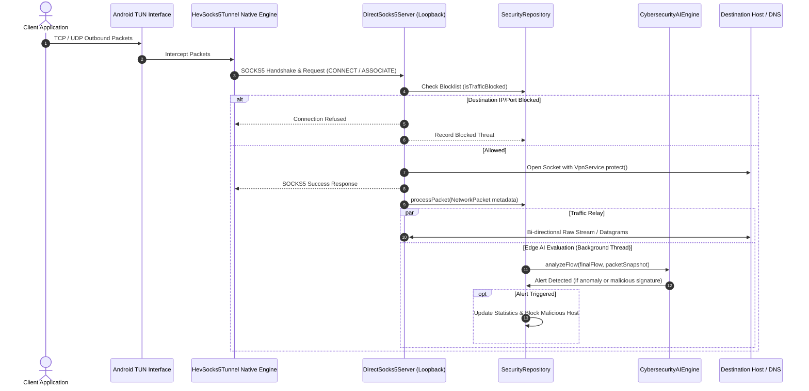
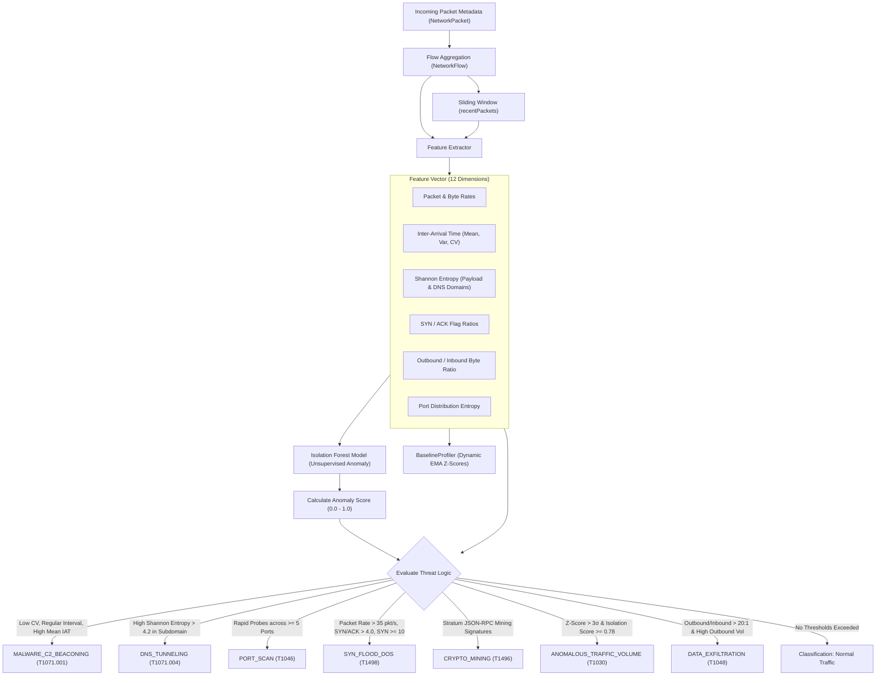
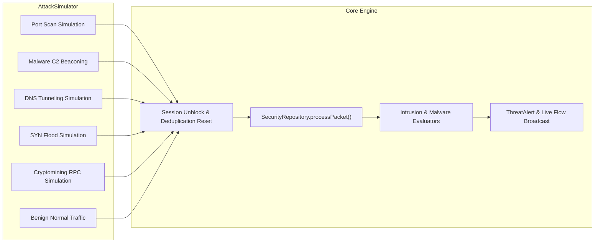

# EdgeSecAI - On-Device AI Cybersecurity Monitor

EdgeSecAI is an offline-first Android cybersecurity monitoring and intrusion detection system. It intercepts device traffic locally using an Android `VpnService` with a high-performance native TUN-to-SOCKS5 proxy, computes multi-dimensional flow metrics, and analyzes network flows using a local machine learning engine (Isolation Forest anomaly detector paired with behavioral heuristics) without exfiltrating telemetry to cloud backends.

---

## Architecture Overview



---

## Traffic Interception & Forwarding Pipeline



---

## On-Device AI & Threat Detection Engine

The AI subsystem operates purely on device with zero cloud latency and no privacy risks.



---

## Attack Simulator

The built-in Attack Simulator allows testing the detection engine, dashboard counters, flow list, and alert feeds on demand without external offensive tools:



- **Port Scan**: Simulates rapid vertical reconnaissance probes across 10 common service ports (21, 22, 23, 80, 443, 8080, 4444, 3389, 5900, 8443) to trigger `PORT_SCAN` alerts and auto-block the attacking host.
- **C2 Beaconing**: Injects clock-regular heartbeat transmissions (inter-arrival time CV < 0.15) to simulate Command & Control agent telemetry (e.g., Cobalt Strike, Mythic).
- **DNS Tunneling**: Transmits high-entropy base64/hex payload subdomains to simulate exfiltration utilities (iodine, dnscat2).
- **SYN Flood**: Sends a burst of 35 SYN packets at sub-15ms intervals to validate Denial of Service detection.
- **Cryptominer**: Emits Stratum JSON-RPC subscription payloads (`mining.subscribe`) on pool ports (3333) to trigger malware resource-hijacking alarms.
- **Benign Traffic**: Simulates clean DNS queries and HTTPS flows to calibrate the dynamic baseline profiler.

---

## Current Status & Verification

- **Real-Time Monitoring**: Direct SOCKS5 proxy running on loopback forwards all TCP and UDP traffic with zero external dependencies.
- **Edge AI Evaluation**: Isolation Forest and rule heuristics evaluate every flow in background executors without dropping frame rates.
- **Interactive UI**:
  - **Dashboard**: Live shield toggle, packet counter, active flow tally, threat counters, anomaly meter, and device throughput gauges.
  - **Alerts**: Real-time threat feed with MITRE ATT&CK mappings, AI forensic diagnosis, and one-tap IP blocking.
  - **Flows**: Live flow monitor with classification status, port endpoints, and packet volume.
  - **Simulator**: Test interface with immediate feedback.
  - **Assistant**: Offline cybersecurity assistant and incident response advisor.

---

## Build & Run

### Prerequisites
- JDK 17
- Android SDK Platform 37 (Min SDK: 33)
- Android Gradle Plugin 9.5.2+
- Android Studio Ladybug / Meerkat or later

### Build Debug APK
```powershell
.\gradlew.bat app:assembleDebug
```
Output: `app/build/outputs/apk/debug/app-debug.apk`

### Install to Connected Device / Emulator
```powershell
.\gradlew.bat app:installDebug
```

---

## License & Third-Party Credits
- **HevSocks5Tunnel**: Native TUN/SOCKS5 forwarder engine, licensed under the MIT License. See [app/src/main/assets/THIRD_PARTY_NOTICES.txt](app/src/main/assets/THIRD_PARTY_NOTICES.txt).
